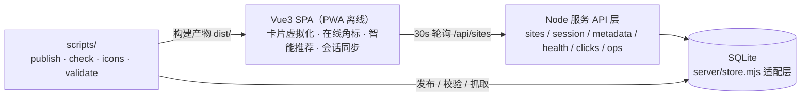

---
# 以下两个链接是「历史溯源」：交代当初为什么这么做，不是把过期文档当成现状。
# 逐条声明（而非整篇放行），见 tools/doc-manager/lib/checker.mjs 的 stale-reference 规则。
historical-links:
  - docs/nav-console-next-plan.md
  - docs/NAV-v5-upgrade-plan.md
---

# Navigator — 网站导航中心

现代化网站导航中心，聚合 300 个优质站点，覆盖 AI 工具、加密货币、开发者工具、基础服务等领域。

线上地址：https://navigator-v2.bot-keep.xyz/（自有服务器 BotKeep，完整 Node 服务，部署目录 `dist/`）
GitHub 仓库：https://github.com/arwei944/navigator-v2

> 发布通道由 `shared/publisher.mjs` 注册表决定（默认 `botkeep`；可用 `NAV_PUBLISHER` / `NAV_SITE_URL` 覆盖）。
> 历史地址：`navigator-v2-two.vercel.app`（2026-10-11 被 Vercel 停用，全站 402）、`nav-dashboard-19166.app.workbuddy.host`（WorkBuddy 云端，现为回退通道）。

## 技术栈

- **前端框架**: Vue 3 + Vite 5 + Pinia + Vue Router
- **搜索**: Fuse.js 模糊搜索 + pinyin-pro 拼音索引（全拼 + 首字母）
- **样式**: CSS 变量主题系统（明暗模式 + 4 套预设主题）
- **PWA**: Service Worker 离线支持，可安装为桌面/移动应用
- **数据真相源**: 服务端 SQLite（`server/store.mjs` 提供与 Blob 同名同签名的适配层；站点数据热更新，无需改代码即同步线上）
- **智能能力**: 站点实时在线状态角标 + 基于历史/分类共现的智能推荐
- **会话同步**: 收藏/待办/偏好按会话密钥云端同步（多设备一致）
- **部署**: 自有服务器 BotKeep（通道由 `shared/publisher.mjs` 注册表决定，本地 `scripts/publish.mjs` 为唯一发布入口）
- **本地运维控制台**: Node 原生 HTTP + SSE 实时日志的单页控制台（`tools/console`，仅监听 `127.0.0.1`）
- **CI/CD**: GitHub Actions 门禁（数据校验 + 构建 + 全量门禁）+ release-please 自动版本与 CHANGELOG

## 架构概览



- **运行时数据唯一来源**：服务端 SQLite 中的 `sites.json`（`server/store.mjs` 提供 Blob 同名同签名适配层；首启自动从 `api/sites-data.json` 导入）
- **本地种子**：`api/sites-data.json` 仅作存储为空时的兜底，由 `scripts/publish.mjs` 保持同步
- **热更新**：前端每 30s 轮询 `/api/sites`（`Cache-Control: no-store`）+ 标签页回到前台立即重拉，发布后秒级可见
- **本地覆盖层**：`src/stores/sites.js` 把「云端基底 + 本地覆盖层（`nav-sites-overlay`：新增/修改/删除墓碑/排序/访问计数）」拼成渲染列表，轮询只换基底不清覆盖层，访客的本地改动不会被云端数据冲掉；管理端发布成功后清层（内容已进云端）
- **读取一致性**：`api/sites.js` 经 `shared/site-store.mjs` 的 CAS 写入 + etag 条件读，发布后**首次**读取即拿到最新版本；并发写冲突返回 409，不会静默丢更新
- **在线状态**：`src/stores/health.js` 仅探测当前可见卡片，60s 缓存 + 6 路并发，卡片角标显示在线/限流/失效
- **会话同步**：`api/session.js` 以会话密钥为隔离凭证（`session/<key>.json`），字段级合并，与站点热更新互不冲突
- **本地数据版本化**：localStorage 持久化的 stores 统一附加 schema 版本号，未来结构变更可平滑迁移

## 功能特性

- [x] 多搜索引擎切换（Google / Bing / 百度 / DuckDuckGo / Perplexity）
- [x] 站点搜索（名称 / 描述 / URL / 拼音全拼 / 拼音首字母）
- [x] 多分类体系（AI / 币圈 / 工具 / 基础服务，30 个子分类）
- [x] 网格视图 / 列表视图切换
- [x] 站点管理：添加 / 编辑 / 删除（右键菜单 + 回收站恢复）
- [x] 批量操作：批量选择 + 批量删除
- [x] 拖拽排序 + 真实网站 favicon 图标
- [x] 收藏站点 + 访问记录追踪（最近 50 条）
- [x] 排序：默认 / 名称 A-Z / 热度 / 最近添加
- [x] 主题系统：4 套预设 + 明暗模式 + 自定义壁纸
- [x] 侧边栏可拖拽调节宽度、右侧站点详情面板
- [x] 统一设置面板 + 命令面板（Ctrl+K）
- [x] 数字时钟 + 待办事项面板
- [x] 书签导入 / 导出（浏览器 HTML 书签）
- [x] 管理后台（在线新增/编辑/删除 + 发布到云端，数据洞察统计）
- [x] 站点实时在线状态角标（在线/限流/失效，仅探测可见卡片）
- [x] 智能推荐（基于访问历史与分类共现的"为你推荐"）
- [x] 云端会话同步：输入同一密钥在多设备间同步收藏/待办/偏好
- [x] 卡片虚拟化（content-visibility），站点增多滚动依旧流畅
- [x] PWA 离线支持

## 常用命令

```bash
pnpm install         # 安装依赖（仓库锁定 pnpm，pnpm-lock.yaml 为唯一锁文件）
pnpm run dev         # 本地开发
pnpm run build       # 构建
pnpm run console     # 本地运维控制台 → http://localhost:5175（仅监听 127.0.0.1）
pnpm run console:autostart  # 控制台登录自启 + 保活任务 + 桌面/任务栏快捷方式
pnpm run nav         # 智能体 CLI：站点/发布/Git/数据 四域 35 条命令（pnpm run nav help）
pnpm run mcp         # MCP 服务：把同一套能力收敛成 6 个域级工具，供智能体原生调用（stdio）
pnpm run mcp:test    # MCP 端到端用例：真实 stdio 握手 + 工具契约与写操作闸门断言
pnpm run publish     # 一键发布：备份 → 数据校验 → 构建 → 部署 → 云端热更新 → 轮询验证
pnpm run watch:deploy # 保存即部署：常驻监听本地变更，自动构建并发布到生产（见下）
pnpm run console:test # 控制台来源校验用例（Host/Origin/自定义头，13 条断言）
pnpm run console:test:all # 控制台全量用例：来源校验 + 元信息推断 + SSRF 防护 + hunk 分块
pnpm run validate    # 站点数据 schema 校验（发布门禁与 CI 会自动调用）
pnpm run check       # 健康检查：探测所有站点可访问性
pnpm run check:report # 健康检查并生成 Markdown 报告
pnpm run icons       # 抓取/补抓网站 favicon
pnpm run perf        # 生成卡片虚拟化滚动基准页（默认 1000 卡片，可 --count N）
node scripts/fix-sortorder.mjs   # 清理 sortOrder 重复/空洞，重排为连续序列（自动备份）
pnpm run publish -- --key=<k> --webhook=<url> # 发布 + 成功后 webhook 通知
pnpm run perf -- --count 2000    # 生成 2000 卡片基准
```

### 发布脚本参数

```bash
pnpm run publish -- --skip-build   # 跳过前端构建，仅热更新云端数据
pnpm run publish -- -k <密钥>      # 显式传管理密钥（-k / --key=，否则读 .env.local / 环境变量）
pnpm run publish -- -w <webhook>   # 发布成功后向该 URL POST 一条通知（-w / --webhook=）
```

### 保存即部署（`watch:deploy`）

`pnpm run watch:deploy` 常驻监听 `src/ shared/ api/ public/` 与 `index.html / vite.config.js / vercel.json / package.json`，
停止编辑 8 秒后自动发布到生产。**按变更类型分流**，避免误伤云端数据：

| 变更 | 执行 |
| --- | --- |
| 只有代码 | `npm run build` → `node scripts/deploy-botkeep.mjs --skip-build`（完全不碰线上站点数据） |
| 数据变了（`api/sites-data.json`） | `publish --skip-build`：复用其备份 / schema 校验 / 快照 / 热更新 / 收敛验证 |
| 两者都变 | 构建一次，再走 `publish --skip-build` |

```bash
pnpm run watch:deploy -- --dry-run       # 只打印将要执行的命令，不真正构建/部署
pnpm run watch:deploy -- --no-data       # 只同步代码，不推送站点数据
pnpm run watch:deploy -- --debounce=3000 # 自定义防抖（最小 1000ms）
```

`dist` / `node_modules` / `backups` / `tools` / `probe` / `docs` 及编辑器临时文件不触发部署；改 `scripts/` 本身也不触发。
部署失败会保留待部署标记并在下次改动时重试，审计写入同一条 `tools/console` 审计流。

> CLI 参数统一用 Node 内置 `parseArgs` 解析（`publish.mjs`、`check-sites.mjs` 均支持）。

### 卡片虚拟化压测

生成 `perf-report/scroll-bench.html` 后，在该目录起静态服务器（`python -m http.server 5500`）浏览器打开，点「开始自动滚动」即可对比 content-visibility ON/OFF：
1000 张较复杂卡片 ON 状态平均 ~60fps、最低 ~60fps 稳定达标，OFF 平均跌至 ~49fps、最低 ~43fps（实测 v89）。站点数量增长后滚动依旧流畅。

### 响应式断点

桌面端自适应随网格列数切换，侧边栏可折叠（桌面 240px / 折叠 60px）、移动端为顶栏 + 遮罩抽屉模式（`MobileHeader`）：

| 视口宽度 | 网格列数 |
|----------|---------|
| `≥1440px` | 4 列 |
| 默认（1024–1440） | 3 列 |
| `≤1024px` | 2 列 |
| `≤768px` | 1 列（移动端） |

## 本地运维控制台

`pnpm run console` 启动，仅监听 `127.0.0.1:5175`（**绝不可部署**）。零框架依赖（Node 原生 `node:http`），单页 UI + SSE 实时日志。

| 面板 | 能力 |
|------|------|
| 概览 | 运行环境、环境变量是否就绪、SSE 与子进程日志管道自检 |
| 站点 | 站点增删改（写 `api/sites-data.json`）、元信息抓取、图标抓取落盘、一键同步云端（提交→推送→备份→门禁→热更新→收敛） |
| 改动 | 文件列表（含增删行数）、单文件 diff 行级高亮、暂存 / 取消暂存、**按 hunk 分块暂存**（等价 `git add -p`，只搬选中的块） |
| 提交 | 规则式变更摘要 + 建议提交消息（Conventional Commits）、提交 / 提交并推送 / 预演推送 |
| 同步 | 发布门禁（预检 → 放行，凭证绑定工作区指纹）、一键发布全链路时间线、**云端数据快照与一键回滚**、云端版本对比 |
| 历史 | 提交记录 + 「已推送 / 仅本地」标注 + 按 commit SHA 关联本机发布记录（`.deploy-history.json`） |
| 数据 | 工作区 vs HEAD 站点数据 diff、分类分布、完整性体检（图标/配色/描述缺失、sortOrder 重复与空洞、域名重复） |
| 可用性 | 站点可用性看板：状态徽标 + 响应时间趋势 + 探活轮次，口径与 `nav sites check` 同源，结果按天落盘 |
| 审计 | 操作审计留痕：提交 / 推送 / 发布 / 放行 / 拒绝 / 回滚 / 站点增删改，支持按动作与结果筛选 |

实时日志区（底部）：

- **多任务切换**：任务下拉列出全部任务（状态标记 + 起始时间 + 标题），每个任务各留一份前端缓冲，切换时经 SSE 回放，互不串行
- **过滤与搜索**：关键字实时过滤并 `<mark>` 高亮（支持 `/正则/` 语法）；`输出 / 信息 / 成功 / 错误` 四级按流筛选
- **跟随与复制**：默认跟随最新行，手动上滚自动暂停跟随；「复制」导出当前可见（已过滤）的日志

设计取舍：

- **单一发布入口**：控制台不重复实现发布逻辑，只编排并可视化 `scripts/publish.mjs`，避免两套发布链路漂移
- **零新增依赖**：Git 操作直接封装 `git` CLI（放弃 `simple-git`），HTTP 用 `node:http`，实时推送用 SSE（原生断线重连）
- **安全边界**：仅监听回环地址；**所有**请求（含静态资源与读接口）在入口统一校验「Host 必须为回环地址 + Origin 若存在必须同源 + 非 GET 需自定义头 `X-Nav-Console`」，阻断 DNS rebinding 与跨站伪造；管理密钥不落盘、不回显；`pnpm run console:test` 用 13 条断言覆盖该矩阵
- **图标宁缺勿错**：图标来源依次为「页面声明 → `/favicon.ico` → `favicon.im`」；`data:,`（抑制请求）视为未声明，`data:image/…` 内联图标则本地解码落盘，并识别拒收 `favicon.im` 的灰色占位图，避免把假图标落盘（无图标时前端回落为分类色首字母块）
- **主题可切换**：深色 / 浅色 / 跟随系统三态（顶栏按钮循环切换，选择存 `localStorage`）。两套配色共用同一组语义变量（`--bg` / `--text` / `--tint-*` / `--diff-*-fg` …），`<html data-theme>` 只切换取值；首屏有内联防闪烁脚本，浅色下正文对比度均 ≥ 4.5:1（WCAG AA）

> M8（安全收口 + 日志增强）已落地；V5 又补上发布门禁、云端快照回滚、操作审计、可用性看板与 hunk 分块暂存。
> 控制台原定的 M9/M10 方向与验收定义见 [`docs/nav-console-next-plan.md`](docs/nav-console-next-plan.md)。
> M9 实际被**智能体 CLI** 占用；V5 方案见 [`docs/NAV-v5-upgrade-plan.md`](docs/NAV-v5-upgrade-plan.md)。
>
> 三端同步、省空间备份与浏览器临时工作区的实现说明见
> [`docs/sync-and-ingest-v0.1.md`](docs/sync-and-ingest-v0.1.md)。

### 开机自启与桌面快捷方式

控制台以「登录自启 + 保活」计划任务常驻，并配 Chrome app 模式快捷方式（无地址栏，点击即开）。

```bash
pnpm run console:autostart            # 注册自启任务 + 立即拉起 + 同步快捷方式
pnpm run console:autostart:uninstall  # 移除自启任务
pnpm run console:start                # 启用任务并立刻启动
pnpm run console:stop                 # 停用任务并停掉进程
pnpm run console:shortcuts            # 只重建桌面/任务栏快捷方式
pnpm run console:icon                 # 由 icon-src.jpg 重新生成 app.ico
pnpm run console:service              # 改走 NSSM 真服务（需账户有密码，见下）
```

设计取舍：

- **为什么不是 Windows 服务**：本机 `Administrator` 账户**没有密码**，而 Windows 拒绝空密码账户做服务登录 —— 即便已授予 `SeServiceLogonRight`，`sc start` 仍报 `1069 logon failure`（实测）。想改回真服务需先给账户设密码，再跑 `pnpm run console:service`（脚本已内置 NSSM 获取/安装/账户绑定/卸载）。
- **登录自启 ≡ 开机自启**：控制台只监听 `127.0.0.1`，登录前没人能用它，所以不必为此给账户设密码。
- **保活不靠常驻看门狗**：任务动作是幂等的 `ensure-console.ps1`（健康则秒退，不健康才拉起），同一任务挂两个触发器 —— 登录触发 + 每 5 分钟兜底。
- **以交互用户身份运行**：因此控制台里的 `git push` 能用上 Git Credential Manager 已存的凭据（`credential.helper=manager`，本机已存 `gh:github.com:arwei944`）。这是坚持「当前用户」而非 `LocalSystem` 的唯一理由。
- **端口必须钉死**：`server.mjs --strict-port` 关掉「占用则 +1 顺延」，否则端口漂移会让快捷方式指向空端口（不带该开关时保留漂移，方便本地多开调试）。
- **stop 会同时停用任务**：否则 5 分钟后的保活会把它拉回来，出现「停了又活」；用 `console:start` 重新启用。
- **拉起一律走计划任务**：`schtasks /run` 派生的进程不继承终端句柄。直接在终端里 `Start-Process` 拉起 node 会让它持有 npm 的 stdout 管道，`pnpm run console:*` 会永远等不到 EOF 而「卡住」（`ensure-console.ps1` 内部的 `Start-Process` 只跑在任务上下文，那里没有 npm 管道）。
- **本机不要用 `Get-NetTCPConnection` 查端口**：它走 CIM，实测 34~40 秒（`netstat -ano` 0.41s、`TcpClient.Connect` 0.04s）。launcher 已统一改用 `lib.ps1#Get-PortListener` / `Test-PortListening`，控制台掉线后拉起耗时 35s → 5.9s。

`tools/console/launcher/` 脚本一览：

| 脚本 | 作用 |
|------|------|
| `install-autostart.ps1` | 注册/移除「登录自启 + 保活」计划任务，并同步快捷方式 |
| `ensure-console.ps1` | 幂等保活：健康则退出，否则拉起（计划任务的动作） |
| `start.ps1` / `stop.ps1` | 启用并启动 / 停用并停止 |
| `sync-shortcuts.ps1` | 桌面 + 任务栏 Chrome app 快捷方式（指向 `--app=http://127.0.0.1:5175`） |
| `build-icon.ps1` + `make-icon.mjs` | 源图居中裁切（去水印）→ 256×256 → 打包 `app.ico` |
| `install-service.ps1` / `set-service-account.ps1` | NSSM 服务路线（账户需有密码；含日志轮转/崩溃重启） |
| `lib.ps1` | 共享工具：node 定位 / 健康探测 / 端口探测 / 任务拉起 / 原生调用（PS 5.1 引号修正） |

> ⚠️ 这些 `.ps1` **必须存为 UTF-8 with BOM**。Windows PowerShell 5.1 对无 BOM 文件按 GBK 解码，中文会变乱码并直接导致语法错误（`Unexpected token`）—— 症状与排查见 HANDOVER。

## 智能体 CLI（nav）

控制台是给人看的（浏览器 + SSE），`tools/cli` 是给**智能体与脚本**用的命令行入口，覆盖 9 个命令域共 **54 条命令**，业务逻辑与控制台同源（复用 `tools/console/lib/` 下按职责分层的模块）。

```bash
pnpm run nav                       # 全部命令总览
pnpm run nav schema                # 机器可读清单（命令 / 选项 / 退出码 / 输出约定）
pnpm run nav data doctor           # 环境自检：Node/git/curl/密钥/数据文件/图标目录
pnpm run nav sites list --category data
pnpm run nav sites add --url example.com --name 示例 --desc 描述 --category learning --dry-run
pnpm run nav publish run --dry-run  # 发布前检查前置条件（blockers 直接说明为什么会失败）
pnpm run nav git hunks api/sites.js # 列出 hunk 边界，再用 git stage-hunks 只暂存其中几块
```

| 命令域 | 命令 |
|--------|------|
| `release` | plan / run / status |
| `sites` | list / get / add / update / remove / categories / meta / icon / check / dedupe |
| `publish` | status / run / verify / sync-data / deployments / preflight / snapshots / rollback |
| `ops` | history / notify / audit / alert-rules / alerts / plugins / health |
| `git` | status / diff / hunks / log / suggest / stage / unstage / stage-hunks / unstage-hunks / commit / push / remote |
| `uptime` | status / history / probe |
| `data` | stats / integrity / diff / validate / doctor / audit |

**输出契约**：stdout 只有一份结果文档（默认单行 JSON `{ok,command,data,meta}`，`--pretty` 转人类可读文本），进度与长任务日志一律走 stderr，因此 stdout 可直接 `JSON.parse`。

**退出码**：`0` 成功 / `1` 内部错误 / `2` 用法错误 / `3` 环境缺失 / `4` 远端失败 / `5` 业务拒绝 —— 可直接作为智能体的判定依据。

**写操作可预演**：`add` / `update` / `remove` / `icon` / `commit` / `push` / `publish run` / `sync-data` 默认直接执行，加 `--dry-run` 则只校验并展示将要发生的变化，不落盘、不推送。预演走的是与实写**同一套校验与 ID 计算**（`lib/sites.mjs` 的 `{ dryRun }` 参数），因此预演结果与真实执行完全一致。

### MCP 服务（智能体原生接入）

`tools/mcp/server.mjs` 用官方 `@modelcontextprotocol/sdk` 以 stdio 暴露同一套能力，但**刻意收敛成 6 个域级工具**（`nav_status` / `nav_sites` / `nav_publish` / `nav_ops` / `nav_git` / `nav_data`），而不是把 54 条命令平铺成 54 个工具 —— 工具数膨胀会显著拉低智能体的选择准确率。

**写操作闸门**：MCP 侧的写操作默认**只预演**，返回 `gate.preview = true` 与将要发生的变化；必须显式传 `confirm: true` 才真正执行。命令清单的唯一真相源是 `tools/cli/lib/registry.mjs`，CLI 与 MCP 都从它取，因此两边不会出现清单漂移。

> 详见 [`tools/cli/README.md`](tools/cli/README.md)。

## CI/CD

| 工作流 | 触发 | 作用 |
|--------|------|------|
| `ci.yml` | push / PR | 数据 schema 门禁（`validate`）+ 构建（`build`）+ **全量门禁**（`console:test:all --ci`），只做门禁、不重复部署 |
| `release-please.yml` | push 到 `master` | 依 Conventional Commits 推断语义化版本、生成 `CHANGELOG.md`、开 release PR |

> 发布仍以本地 `scripts/publish.mjs` 为唯一入口（Git 集成未开启），CI 不参与部署，避免「代码自动部署」与「数据热更新」两条链路互相覆盖。

### CI 里的门禁怎么跑

CI 跑的是**与本地相同的全部门禁**，不是缩水版。两处差异都由脚本头注释自声明，
而不是在 workflow 里硬编码名单：

| 声明 | 含义 | 当前使用者 |
|------|------|-----------|
| `@ci-skip <原因>` | 该门禁依赖本机资源，CI 里**跳过并打印原因** | `test-input-focus-real`（需要本机 Chrome） |
| `@ci-flags --strict` | CI 里追加该参数 | `test-bundle`、`test-bundle-size`（缺 `dist/` 时本地允许跳过，CI 必须失败） |

两条规则的意图相同：**不允许静默降级**。

- 没写 `@ci-skip` 的门禁一定会跑；写了但没写原因 → 直接失败。
- 跳过的门禁在日志里逐条列出「哪几道、为什么」，总数变小肉眼可见。
- 全被跳过视为失败（说明声明写得太宽，CI 实际什么也没验）。
- `@ci-flags --strict` 防的是另一种假绿：构建没产物 → 产物体积门禁自己 `exit(0)` → 报绿。

## 环境变量

复制 `.env.example` 为 `.env.local`；服务端部署时由运行环境注入同名变量（发布沙箱无注入时，构建脚本回填到 `data/` 下的小文件，启动时读回）。变量注册表见 `shared/env-registry.mjs`，`pnpm run env:doctor` 可自检。

**各平台密钥统一在控制台的「密钥」面板管理**（`pnpm run console` → 密钥）。该面板由 `shared/secrets-registry.mjs` 驱动：写明每把密钥的取值入口、影响范围、是否必需，并支持「验证」——主动向平台发一次只读请求确认还有效。页面上只显示后 4 位，完整值不回浏览器；输入框为密码型且不回填已有值。

> 两类台账的分工：`env-registry.mjs` 是**代码契约**（代码认哪些变量），`secrets-registry.mjs` 是**运维清单**（人需要配哪些平台的密钥）。刻意不合并——合并后任一方新增都会污染另一方语义。

### 数据备份：唯一能兜住平台故障的退路

线上数据只有**一份** `/data/store.db`（SQLite），而平台**没有持久卷**。这意味着容器一旦被平台重建，数据可能直接归零。更关键的是 `data/` 刻意不进部署包（保护线上库），所以**部署这条路径救不回数据**。

控制台的「备份」面板（`pnpm run console` → 备份）把整份 SQLite 拉到本机 `backups/db/`：

- **校验后才落盘**：`PRAGMA integrity_check` + 对象数 + `sites.json` 必须在。下载中断时 HTTP 仍可能 200，不校验就会存下一份回滚不了的"备份"——那比没有备份更危险。
- **自动调度**：控制台启动后每 6 小时检查一次（`NAV_BACKUP_INTERVAL_HOURS`，0 表示禁用），保留最近 24 份。调度器跑在**本机**而非容器内——容器里的备份会随容器一起消失。
- **发布前检查**：`release preflight` 会报告备份新鲜度；传 `requireBackup: true` 可硬阻断。

命令行等价入口：`nav db backup` / `nav db status`。

> 备份**救不了**本机磁盘故障（备份与项目在同一台机器）。要防住这一层，需把 `backups/db/` 同步到云盘或另一台机器。

### 镜像同步：云端变化实时到本地，本机离线也不丢

备份是「按小时拍的快照」，镜像是「逐条追上的副本」，两者互补。

本机关机、休眠、控制台没启动的时候，云端照样在变。如果只是「定时拉全量比对」，那段窗口里的变化就**永久丢失**了——没有任何人在观察。所以这里的做法是**云端自己记账**：`server/store.mjs` 的 `changes` 表在**对象写入的同一个事务**里记一条 `seq`，本机回来时按游标追赶。离线 3 天还是 3 分钟都一样，一条都不会少。

控制台的「镜像同步」面板（`pnpm run console` → 镜像同步）：

- **只读副本**：本地 `backups/mirror/` 绝不回写云端。写入请走发布链路（那边有 CAS 与结构校验）——把镜像当成可回写的副本，它就会变成第二个真相源。
- **自动调度**：默认每 60 秒（`NAV_MIRROR_INTERVAL_SEC`，0 表示只保留手动）。目录可用 `NAV_MIRROR_DIR` 改到别的磁盘。
- **失败不推进游标**：网络故障、单对象拉取失败都保持游标不动，下次从同一位置重试。推进了就会永久跳过，而且是静默的。
- **落后太多自动降级**：日志有保留上限，游标比 `oldest` 还老时中间那段补不回来，此时自动改走**全量对齐**并显式标注——最坏的失败是回一个空结果让你以为「没有变化」。
- **首次同步不空跑**：云端在变更日志上线前就有数据时 `head=0`，会自动降级为全量对齐，而不是「成功 0 变化」。

命令行等价入口：`nav mirror sync`（`--force` 全量对齐）/ `nav mirror status` / `nav mirror objects`。

| 变量 | 必填 | 用途 |
|------|------|------|
| `NAV_MIRROR_INTERVAL_SEC` | — | 自动同步间隔（秒），默认 60；0 表示禁用（只保留手动） |
| `NAV_MIRROR_DIR` | — | 镜像落盘目录，默认 `backups/mirror` |

| 变量 | 必填 | 用途 |
|------|------|------|
| `SITES_ADMIN_KEY` | ✅ | 站点数据发布密钥；显示在管理后台发布按钮旁，**不在请求体明文发送**（走 `Authorization: Bearer <key>` 请求头） |
| `BOTKEEP_API_KEY` | ✅ | BotKeep 部署 API 凭据（`release run` / `deploy-botkeep`） |
| `BOTKEEP_WORKLOAD_ID` | ✅ | BotKeep workload 标识；与 `.deploy-manifest.json` 比对可判断是否换端点 |
| `ADMIN_PASSWORD_HASH` | — | 后台登录口令的 scrypt 哈希；未配则 `/admin` 口令登录返回 500（密钥直连照常可用） |
| `AUTH_SECRET` | — | 会话 token 的 HMAC 签名密钥；缺省回退到 `SITES_ADMIN_KEY` |
| `DEPLOY_SITE_URL` / `NAV_SITE_URL` | — | 发布后验证用的站点地址；发布通道可提供时优先用通道的 |
| `NAV_PUBLISHER` | — | 发布通道选择：`botkeep`（默认）/ `workbuddy` / `vercel` / `rsync-static` |

### 会话同步说明

- 会话数据（收藏/待办/历史/偏好）存于服务端存储的 `session/<key>.json`，**以会话密钥为隔离凭证**，无需管理密钥
- 在「设置 → 数据管理 → 云端会话同步」生成密钥，同一密钥可在不同浏览器/设备间同步
- 管理密钥不硬编码进脚本；`publish.mjs` 从 `.env.local` / 环境变量 / `--key=` 读取，缺失即中止
- 本地持久化数据带 schema 版本号，结构升级时通过 `src/utils/storeVersioning.js` 的迁移表平滑兼容

## 项目结构

```
nav-v2/
├── api/                   # 21 个接口，全部导出 (req, res) handler —— 见下方说明
│   ├── sites.js           # 站点数据 GET/POST（存储适配层，POST 走 header 鉴权）+ 快照清单 / 回滚
│   ├── session.js         # 用户会话数据读写（session/<key>，密钥隔离）
│   ├── metadata.js        # URL 元信息抓取代理（shared/site-infer.mjs，返回名称/描述/分类/配色/图标）
│   ├── auth.js            # 登录、口令校验（scrypt）、会话签发
│   ├── ai.js / translate.js / cover.js              # AI 描述改写、翻译、封面生成
│   ├── clicks.js / health.js / health-history.js    # 点击统计、站点探活、历史曲线
│   ├── ops.js / backup.js / alert-rules.js          # 运维任务、备份、告警规则
│   ├── deploy-status.js / plugins.js                # 部署状态回读、插件注册表
│   └── _local-key.js      # 控制台本地凭据端点（`_` 前缀也是端点名的一部分）
├── shared/
│   ├── site-infer.mjs     # 站点元信息推断引擎（线上 Serverless / 控制台 / CLI 同源复用）
│   ├── categories.mjs     # 分类白名单与元数据（分类推断的唯一真相源）
│   ├── snapshots.mjs      # 云端快照命名与保留策略（纯函数：命名、反解、裁剪）
│   ├── health-probe.mjs   # 站点探活与分级口径（控制台看板 / CLI check / check-sites.mjs 共用）
│   └── hunk-patch.mjs     # unified diff 的 hunk 边界解析与子集补丁生成（分块暂存用）
├── public/
│   ├── icons/             # 真实网站 favicon（按站点 id 存储）
│   └── ...
├── scripts/
│   ├── publish.mjs        # 一键发布（备份/校验/构建/部署/热更新/验证）
│   ├── validate-data.mjs  # 站点数据 schema 校验
│   ├── check-sites.mjs    # 全站点健康检查
│   └── fetch-favicons.mjs # favicon 批量抓取（支持 --only <id>）
├── tools/
│   ├── cli/               # 智能体 CLI（49 条命令 / 7 个域，复用 console/lib，JSON 输出契约）
│   │   ├── nav.mjs        # 入口：分发 / help / schema（命令清单取自 lib/registry.mjs）
│   │   ├── lib/core.mjs   # 内核：输出信封、退出码、参数解析、长任务等待、预演
│   │   ├── lib/registry.mjs # 命令注册表：CLI 与 MCP 共用的唯一真相源
│   │   └── commands/      # sites / publish / snapshots / git / data 五组命令
│   ├── mcp/               # MCP 服务（stdio，官方 SDK）：49 条命令收敛成 6 个域级工具
│   │   ├── server.mjs     # 工具定义与写操作 confirm 闸门
│   │   ├── lib/bridge.mjs # 复用 CLI 命令层，把命令映射成工具动作
│   │   └── test-mcp.mjs   # 端到端用例：真实 stdio 握手 + 工具契约断言
│   └── console/           # 本地运维控制台（仅 127.0.0.1，绝不可部署）
│       ├── server.mjs     # node:http 入口 + 来源校验 + SSE 端点（--strict-port 钉死端口）
│       ├── test-trust.mjs # 来源校验用例（Host/Origin/自定义头，零依赖）
│       ├── test-hunks.mjs # hunk 分块用例（临时仓库实测暂存 / 取消暂存）
│       ├── launcher/      # 登录自启 + 保活 + Chrome app 快捷方式（PowerShell，UTF-8 BOM）
│       ├── lib/           # 业务逻辑，按职责分 6 组（见下方说明）
│       │   ├── core/      # env / secrets / jobs / audit / cloud / gate —— 无业务语义的基础设施
│       │   ├── vcs/       # git / changes —— 版本控制读写
│       │   ├── content/   # sites / data —— 站点数据读写
│       │   ├── observe/   # health / notify / schedule / uptime / history —— 可观测与通知
│       │   ├── publish/   # deploy / release / sync / snapshots / publishlog / plugins / endpoints / vercel
│       │   └── routes/    # api.mjs 分发起 + 6 个域路由（system/git/sites/health/ops/secrets）+ 路由期望清单
│       └── ui/            # 单页 UI（10 个面板 + theme.js 主题 + 日志过滤，零框架依赖）
├── .github/workflows/     # ci.yml（门禁）+ release-please.yml（版本与 CHANGELOG）
├── backups/               # 发布前自动备份的站点数据
├── docs/
│   ├── NAV-v3-upgrade-plan.md      # 站点项目 V3 升级方案（架构止血 / 智能导航 / 体验工程）
│   ├── NAV-v4-upgrade-plan.md      # 站点项目 V4 升级方案
│   ├── NAV-v5-upgrade-plan.md      # 站点项目 V5 方向调研（MCP 服务化 / 发布可回退）
│   └── nav-console-next-plan.md    # 控制台下一版方向调研（M8+）
├── src/
│   ├── components/        # Vue 组件
│   ├── router/            # 路由配置
│   ├── stores/            # Pinia 状态管理（含 health 在线状态、版本化持久化）
│   ├── services/          # API 调用层（含 session 会话同步）
│   ├── utils/             # 通用工具（storeVersioning 本地数据版本化）
│   ├── styles/            # 全局样式 + CSS 变量
│   ├── views/             # 页面视图
│   ├── App.vue            # 根组件
│   └── main.js            # 入口文件
├── HANDOVER.md            # 项目交接 / 发布记录
├── .env.example           # 环境变量示例
├── index.html
├── vite.config.js         # Vite + PWA 配置
├── server/                # 自建 Node 服务：静态资源 + 全部 /api/* + SQLite 存储
└── vercel.json            # Vercel 通道配置（非默认，勿删：见下方说明）
```

### 关于 `api/`（不要当成迁移残留删掉）

`api/` 下 21 个文件**全部**导出 Vercel 风格的 `(req, res)` handler，但它们**没有一个
依赖 Vercel 平台** —— 只用 Node 内置模块与 `shared/` 下的纯函数，没有任何 `@vercel/*`。

所以 `api/` 不是「迁到 BotKeep 后待清理的旧代码」，而是**默认发布通道实际在用的实现源**：

| 谁 | 怎么用 `api/` |
|---|---|
| BotKeep（默认） | `server/main.mjs` 启动时按目录派生路由并全量加载 |
| Vercel（回退通道） | 平台原生识别该目录，无需任何适配 |

签名的意义只是「可移植」。`server/main.mjs` 给原生 `ServerResponse` 补了
`status()` / `json()` 两个方法，因此**接口源码零改动**即可两边通用 —— 改源码会让
`test-guard.mjs` / `test-netguard.mjs` 两套 SSRF 用例的保护范围失效。

**删 `api/` 会同时打断两条通道**，且新增端点只需增加文件（路由表与构建复制清单都按目录派生，
由 `test-server-routes` 保证仓库文件集与部署产物逐一相等）。

### 关于 `vercel.json`（不要删）

Vercel **通道本身仍可用**：`NAV_PUBLISHER=vercel` 可显式切回，部署命令与迁移前逐字一致
（见 `shared/publisher.mjs` 的注册处）。2026-10-11 被平台停用的是旧站点域名
`navigator-v2-two.vercel.app`（fair-use 停用，全站 402），不是这条通道能力。

这个文件定义了该通道的路由契约，**删掉会让回退通道失效**，其中最容易忽略的是：

- `{"handle": "filesystem"}` 必须存在 —— 自定义 `routes` 时 Vercel 不做文件系统兜底，
  缺了它 `/sw.js`、`/manifest.webmanifest` 会被重写到 `index.html`，MIME 变成 `text/html`，
  **Service Worker 注册必然失败、PWA 离线能力整体失效**（这是 2026-10-10 真实踩过的 P0）。
- `sw.js` / `manifest.webmanifest` 的 `Cache-Control: max-age=0, must-revalidate`
  防止旧 SW 被长期缓存。

日常发布走的是 BotKeep，不经过这个文件；它只在显式回退时生效。

## 分类体系

| 大类 | 子分类（节选） |
|------|--------------|
| AI 学习 | 入门对话 / 提示词 / 写作 / 编程 / 设计 / 工作流 / 学习 / 优惠比价 |
| 币圈 | CEX / DEX / DeFi / 数据 / 投融资 / 钱包 / 链上工具 / NFT / 安全 / 媒体 / 挖矿 / 稳定币 / AICrypto / 空投 |
| 工具 | 短信接码 / AI API 平台 / 账号卡密 / 项目参考 |
| 基础服务 | 云服务器VPS / 域名服务 / 代理VPN |

## License

MIT