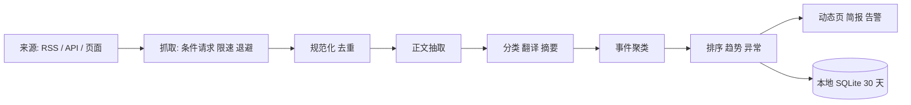

# 领域动态与情报模块 · 演变路线图

> 目标：从「聚合各领域最新动态」起步，逐阶段演进到**顶级情报级**：
> 覆盖广、时效高、事件化、可溯源、能发现趋势与异常，并输出可行动的报告。
>
> 本路线图基于 2026-10-22 对仓库现状与开源实现的调研。

## 一、约束（已确认）

| 项 | 选择 |
|---|---|
| 抓取与存储 | **仅本地**（本机常驻服务 + 本地 SQLite） |
| LLM | **较高**：摘要 + 事件聚类 + 每日简报 |
| 条目保留 | **30 天** |
| 领域 | 复用现有 4 域 / 25 分类，不另造目录 |
| 线上展示 | 第一版不做；后续可用「静态快照发布」把结果推到线上 |

## 二、现状与差距

已有底座：

- 受控 HTTP 抓取（`shared/http-fetch.mjs`，带字节上限）
- LLM 链（`shared/llm-engine.mjs`）、翻译链（`shared/translate-engine.mjs`）
- 站点库与分类（4 域 / 25 分类）、插件注册表、后台面板、审计、备份、三端同步
- 本地 SQLite 存储与定时任务骨架

缺口：

- 没有 RSS/Atom/JSON Feed 解析
- 没有正文抽取、内容指纹去重、事件聚类
- 没有结构化条目存储与 30 天 TTL
- 现有 `ContentFeed` 只是「最近访问 / 热门站点」，不是内容动态

## 三、情报能力模型（用来衡量“顶级”）

| 层级 | 能力 | 达标表现 |
|---|---|---|
| L1 聚合 | 多源采集、去重、领域分类 | 20+ 稳定源，重复率 < 1% |
| L2 理解 | 正文抽取、翻译、摘要 | 每条有可读中文摘要与回链 |
| L3 事件化 | 同一事件多源合并、时间线 | 事件合并准确率 ≥ 90%（抽检） |
| L4 洞察 | 趋势/异常、实体、可信度 | 能回答“为什么重要”“谁在推动” |
| L5 行动 | 每日简报、告警、检索、反馈 | 每日一份可用简报；误报可纠正 |

路线图按 L1 → L5 推进，不跳级。

## 四、参考实现与理论

| 参考 | 借鉴点 | 采用方式 |
|---|---|---|
| RSSHub | 无 RSS 站点的适配器 | 阶段 2 起作为外部源 |
| Miniflux | 条件请求、定时刷新、Readability 全文 | 直接采纳 |
| changedetection.io | 选择器、差异比较、按源调度 | 阶段 2 页面监控 |
| Trafilatura / Readability | 正文与元数据抽取 | 阶段 1 用 Node Readability |
| BERTopic | embedding → 聚类 → c-TF-IDF → 增量 | 阶段 1 用轻量 TF-IDF/embedding 聚类 |
| GDELT | 事件、实体、情绪、15 分钟更新 | 阶段 3 作为外部事件源 |
| WebSub | 推送替代轮询 | 阶段 3 可选 |
| Hacker News API | 增量端点、无严格限流 | 阶段 0 首批源 |

理论要点：

- 增量抓取：`ETag / If-None-Match / Last-Modified`，304 不重复下载
- 去重：URL 规范化 + 内容指纹；大规模再上 SimHash/MinHash
- 抽取：Readability 类算法，只存标题、摘要、回链
- 聚类：TF-IDF/embedding + 余弦 + 层次聚类/HDBSCAN
- 排序：时间衰减 + 来源权重 + 互动量（HN/Reddit hot）
- 合规：robots.txt、限速、User-Agent、摘要不全文转载

## 五、总体架构



- **独立数据库** `data/content.db`，与站点库 `store.db` 分离：
  避免内容量把站点主库撑大，也让 30 天清理不影响站点数据。
- **本地调度器**：`server/content-cron.mjs`，仅在 `NAV_CONTENT_ENABLED=1` 时启动。
- **插件化 provider**：`collectors`（rss/api/page-change）、`processors`
  （extract/translate/summarize/cluster/trend），沿用现有注册表风格。

## 六、数据模型

```text
sources(id, url, type, domain, category_id, weight, enabled,
        etag, last_modified, last_fetch_at, fail_count, next_fetch_at)
entries(id, source_id, url, title, author, published_at, fetched_at,
        lang, excerpt, summary, content_hash, category_id, domain,
        score, read, saved, raw_bytes)
events(id, title, summary, first_seen, last_seen, entry_count,
       heat, category_id, entities_json, importance)
event_entries(event_id, entry_id)
digests(date, content_md, created_at)
fetch_log(id, source_id, at, status, http_status, bytes, duration_ms, error)
```

保留策略：

- `entries / events / digests`：30 天
- `fetch_log`：7 天
- `sources`：永久
- 不存原始 HTML，只存抽取后的摘要与必要元数据

体积估算：每天 300–800 条 × 30 天 ≈ 1–2.4 万条；
每条约 1–2 KB → **20–50 MB**，本地 SQLite 可承受。

## 七、分阶段路线图

### 阶段 0 · 地基与 MVP（L1）

范围：

1. 源管理：RSS/Atom/JSON Feed + HN API + arXiv API（首批 15–20 个，逐一验证可达性与许可）
2. 抓取：条件请求、并发 4、单源超时 15s、失败指数退避、robots.txt 缓存
3. 存储：`content.db`、30 天 TTL、每日清理
4. 处理：URL 规范化、内容指纹去重、规则分类（4 域/25 类）、标题清洗
5. 前端：动态时间线、领域/分类筛选、搜索、已读/收藏、源管理面板
6. 运维：抓取状态、失败源、审计、手动刷新

不做：正文抓取、LLM、聚类、简报。

验收：

- 20 个源中 ≥ 95% 抓取成功；单轮 ≤ 2 分钟
- 重复条目 < 1%；每条有标题、时间、来源、回链
- 页面 P95 < 300ms；30 天清理可复现

预计：约 1 周 / 15–20 个文件。

#### 阶段 0 实现状态（2026-10-22）

已完成：

| 文件 | 作用 |
|---|---|
| `shared/content-core.mjs` | RSS/Atom/JSON Feed 解析、清洗、指纹去重、分类、退避（纯函数） |
| `shared/content-sources.mjs` | 24 个已验证源 + 默认参数 |
| `server/content-store.mjs` | 独立 `data/content.db`、源/条目/抓取日志、30 天 TTL |
| `server/content-fetch.mjs` | 条件请求、逐跳重定向校验、robots、HN/arXiv/GitHub/V2EX 适配 |
| `server/content-cron.mjs` | 本地调度器（默认 20 分钟） |
| `api/content.js` | 列表/统计/源管理/刷新/已读/收藏（惰性加载） |
| `src/views/ContentView.vue` | `/content` 领域动态时间线 |
| `src/components/admin/AdminContentSources.vue` | 后台「内容源」管理 |

运行：

```bash
export NAV_CONTENT_ENABLED=1
export NAV_CONTENT_DB="$PWD/data/content.db"
export NAV_CONTENT_INTERVAL_MIN=20
```

实测首轮：25 个源 → 22 个成功，新增 374 条（30 天内），
领域分布 `ai-work 150 / infra 100 / onchain 81 / research 47`。
CoinDesk 与 arXiv 在测试网络上连接超时，已按退避处理，不影响其余源。

边界：

- 仅本地：线上部署包不启用该模块，`/api/content` 会返回 503，不影响其他接口；
- 不做正文抽取、LLM 摘要、事件聚类（阶段 1）；
- 只存标题、摘要、回链，不存全文。

### 阶段 1 · 理解与事件化（L2–L3）

范围：

1. 正文抽取（Readability + linkedom，失败回退 RSS 摘要）
2. 中文翻译（复用现有翻译链，只翻非中文）
3. LLM 摘要与“为什么重要”（批量、缓存、失败降级）
4. 事件聚类：URL/标题指纹 → TF-IDF/embedding 余弦 → 层次聚类
5. 事件卡片：主稿 + 多源关联 + 时间线
6. 热度排序：时间衰减 + 来源权重 + 互动量
7. 每日简报：Top 事件、领域摘要、链接

LLM 成本控制：

- 只处理新条目；同一 URL/内容哈希不重复调用
- 批量 8–10 条/次；失败重试 2 次；超预算降级为规则摘要
- 事件标题与摘要缓存 30 天

验收：

- 摘要可用率 ≥ 95%；中文可读
- 事件合并抽检准确率 ≥ 90%
- 每日简报可生成且 ≤ 1500 字

预计：约 2 周 / 25–30 个文件。

#### 阶段 1 实现状态（2026-10-22）

已完成：

| 能力 | 文件 | 说明 |
|---|---|---|
| 正文抽取 | `server/content-process.mjs` | Readability + linkedom，最近 48h、每轮 12 条 |
| 翻译 | 同上 | 复用翻译链；无端点时保留原文 |
| LLM 摘要 | 同上 | 生成中文摘要 + “为什么重要”；未配置/失败降级规则摘要 |
| 事件聚类 | `shared/content-text.mjs` | TF-IDF + 余弦 + 并查集；清洗 HN/Product Hunt 模板词 |
| 每日简报 | 同上 | LLM 可用时生成；否则规则汇总 |
| 三视图 | `src/views/ContentView.vue` | 时间线 / 事件 / 每日简报 |

当前环境**未配置 LLM 与翻译**（无 `data/ai-config.json`，无 `AI_*`），
所以实测为规则摘要模式：

- 正文抽取：24 条处理，全部成功（两轮各 12 条）
- 摘要：24 条 fallback（保留原文摘要）
- 事件：7 个（修复前曾把 14 条不同 HN 故事误合并成 1 个事件）
- 简报：1 份规则汇总

启用 LLM：创建 `data/ai-config.json`（`baseURL` / `apiKey` / `model`），
或设置 `AI_BASE_URL` / `AI_API_KEY` / `AI_MODEL`。下一轮处理自动切换为 LLM 摘要。

新增环境变量：

| 变量 | 默认 | 说明 |
|---|---|---|
| `NAV_CONTENT_EXTRACT_LIMIT` | 12 | 每轮正文抽取上限 |
| `NAV_CONTENT_SUMMARY_LIMIT` | 12 | 每轮摘要上限 |
| `NAV_CONTENT_LLM_DAILY_MAX` | 100 | 每日 LLM 调用预算（条） |
| `NAV_CONTENT_CLUSTER_THRESHOLD` | 0.55 | 事件聚类余弦阈值 |

### 阶段 2 · 洞察与检索（L4）

范围：

1. 实体抽取（公司、人物、项目、技术）与关系
2. 趋势/异常：滑动窗口、EWMA、突增 z-score、跨源扩散速度
3. 来源可信度：人工权重 + 历史准确率 + 多源交叉
4. 全文/语义检索（SQLite FTS5，必要时 sqlite-vec）
5. 告警：关键词/实体/突增 → 本地通知或 webhook
6. 页面变更监控（changedetection 思路）

验收：

- 突增检测可复现；误报率可统计
- 实体时间线与关系图可用
- 检索 Top-10 命中率抽检 ≥ 85%

预计：约 3 周。

### 阶段 3 · 顶级情报（L5）

范围：

1. WebSub / 页面变更等实时通道（按源启用）
2. 多语言与跨域知识图谱
3. 影响分析：事件 → 实体 → 领域 → 行动建议
4. 自动报告：日报/周报/专题
5. 人工反馈闭环：隐藏、纠正、置顶 → 调整来源与聚类权重
6. 可选：GDELT 等外部事件库融合

验收：

- 关键领域分钟级发现；跨源事件覆盖率可量化
- 报告可直接用于决策；反馈能改变后续排序

预计：持续迭代。

## 八、技术选型

| 能力 | 选型 | 理由 |
|---|---|---|
| RSS/Atom/JSON Feed | `fast-xml-parser` + 自写 JSON Feed 解析 | 成熟、无原生依赖 |
| 正文抽取 | `@mozilla/readability` + `linkedom` | Node 生态、无需 Python |
| 中文分词 | `Intl.Segmenter` | Node 内置，零依赖 |
| 相似度/聚类 | 自写 TF-IDF + 余弦 + 层次聚类 | 30 天万级条目足够 |
| embedding（可选） | 远程 OpenAI 兼容 / 本地 ONNX | 阶段 1 后按效果决定 |
| 存储 | `node:sqlite` 独立 `content.db` | 与现有栈一致 |
| 检索 | SQLite FTS5 | 本地、零服务 |
| 调度 | `server/content-cron.mjs` | 复用现有常驻进程 |
| LLM/翻译 | 现有 `llm-engine` / `translate-engine` | 不重复建设 |
| 前端 | Vue + 现有分类/面板体系 | 一致体验 |

## 九、运行与成本

- 抓取：每 15–30 分钟一轮，按源分片；条件请求为主
- LLM：每天新条目 300–800 条；批量摘要 + 事件标题 + 1 次简报
- 成本公式：`条目数 × 平均 tokens × 单价`；设每日预算上限，超出降级
- 数据库：20–50 MB；每日清理 30 天前数据
- 备份：`content.db` 纳入本地数据库备份；不进入站点三端同步

## 十、合规与安全

- 只抓公开源；遵守 robots.txt 与站点条款
- 明确 User-Agent；限速；失败退避
- 只存标题、摘要、回链；不转载全文、不绕过付费墙
- LLM 输出标注“自动摘要”，保留原文链接
- 来源可一键停用；抓取日志可审计

## 十一、风险与对策

| 风险 | 对策 |
|---|---|
| 源失效 / 改版 | 健康检查、连续失败自动降频/停用、面板提示 |
| 反爬 / 限流 | 条件请求、官方 API 优先、RSSHub 兜底 |
| LLM 成本失控 | 缓存、批量、预算上限、降级规则摘要 |
| 事件误合并 | 阈值 + 人工拆分/合并 + 反馈学习 |
| 数据膨胀 | 30 天 TTL、只存摘要、独立库 |
| 仅本地单点 | 本地数据库备份 + 恢复演练 |
| 线上不可见 | 后续增加“快照发布”，把动态结果推到线上 |

## 十二、待决事项

1. 阶段 1 的 LLM 模型与每日预算上限
2. 是否接受 Python sidecar（Trafilatura/BERTopic），还是坚持纯 Node
3. 阶段 2 是否允许抓取无 RSS 的站点（合规与稳定性取舍）
4. 30 天后是否需要归档“事件级摘要”到更长周期（当前只保留 30 天）
5. 线上展示的时机与形态（静态快照 / 独立只读页）

## 十三、建议的第一刀

按阶段 0 开工：先做**源管理 + 抓取 + 去重 + 30 天存储 + 动态时间线**，
用真实源跑通一周，再进入 LLM 与事件聚类。
这样能先用低成本验证“哪些领域、哪些源真正有信息价值”，
避免在错误的源上投入摘要与聚类成本。
